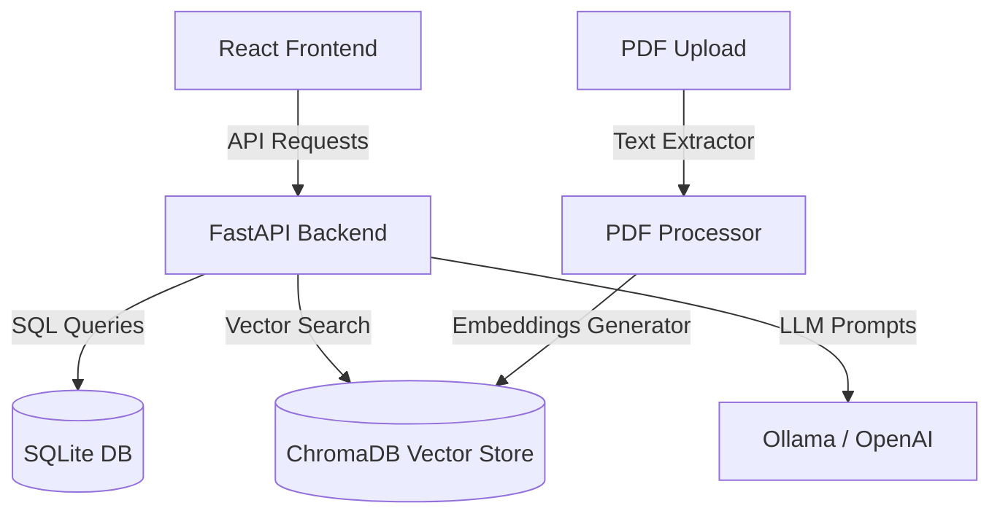

# CSELEC assistant — Walkthrough

We have developed a fully functional prototype of the **CSELEC assistant** web application. It integrates a Python FastAPI backend, a React + TypeScript frontend with Tailwind CSS, and a SQLite + ChromaDB RAG architecture.

## ⚡ Architecture Overview

---

## 👥 Roles & Accounts Created (Database Seeded)

On startup, the SQLite database is automatically initialized and seeded with three default users and realistic electrical manuals.

| Rôle | Email | Mot de passe | Description |
|------|-------|--------------|-------------|
| **Administrateur** | `admin@electricite.com` | `admin123` | Accès au Dashboard, Gestion des utilisateurs, Gestion des documents (Ajout/Indexation PDF), Paramètres. |
| **Technicien** | `ahmed.benali@electricite.com` | `tech123` | Accès au Chat, Historique des conversations, Consultation des documents (Read-only), Profil. |
| **Technicien** | `fatima.zahra@electricite.com` | `tech123` | Accès au Chat, Historique des conversations, Consultation des documents (Read-only), Profil. |

---

## 🛠️ Main Features Implemented

### 1. Authentification & Sécurité
- Common login screen featuring logo and password toggle.
- JWT-based authentication state persisted in local storage.
- Backend routing restrictions preventing technicians from accessing administrator endpoints.

### 2. Espace Technicien
- **Chat avec Assistant IA** : A dynamic chat interface with auto-scrolling, loading dots, markdown formatting for lists/tables, and source citation cards underneath every response.
- **Historique** : Full table listing past conversations with titles, dates, message counts, search, and a direct link to open and resume discussions.
- **Base Documentaire** : Read-only repository table with category dropdown filter and search to view available technical documentation.
- **Profil** : Interactive card showing user account details and profile update form.

### 3. Espace Administrateur
- **Tableau de Bord** : Modern layout showing KPI cards for total users, active technicians, active conversations, and documents. Includes custom bar charts of conversation volume and category distribution.
- **Gestion des Documents** : Full CRUD support for document registers. The file upload process displays a visual step-by-step indicator of the indexation pipeline: **Importation → Extraction → Indexation → Terminé**.
- **Gestion des Utilisateurs** : Complete CRUD for user accounts including status toggling (Actif/Inactif) and password confirmation checks.
- **Historique Global** : Logs all technicians' conversations. Administrators can open any conversation in a read-only modal to audit Q&A logs.
- **Paramètres** : Panel to customize chunk settings, display theme, and inspect system diagnostic info.

---

## 🚀 How to Run the Application

Since terminal commands on Windows can sometimes experience shell resolution issues with folder paths containing spaces, we have created two double-clickable startup scripts in the root directory:

### Step 1: Start the Backend Server
Double-click [demarrer_backend.bat](file:///c:/Users/douaa/4eme%20stage/demarrer_backend.bat). This script will:
- Install the required Python packages from [requirements.txt](file:///c:/Users/douaa/4eme%20stage/backend/requirements.txt)
- Initialize and seed the SQLite database
- Start the FastAPI backend on `http://localhost:8000`

### Step 2: Start the Frontend Server
Double-click [demarrer_frontend.bat](file:///c:/Users/douaa/4eme%20stage/demarrer_frontend.bat). This script will:
- Install Node.js packages from [package.json](file:///c:/Users/douaa/4eme%20stage/frontend/package.json)
- Launch the Vite dev server on `http://localhost:5173`

Open your browser to `http://localhost:5173` and log in with the test accounts provided above.
